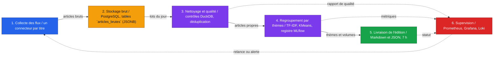

<!-- adam-badges:start -->
[](https://github.com/Adam-Blf/Projet-M2OPS/commits)
[](https://hits.sh/github.com/Adam-Blf/Projet-M2OPS/)
[](https://github.com/Adam-Blf/Projet-M2OPS/commits)
[](https://github.com/Adam-Blf/Projet-M2OPS)
[](LICENSE)
<!-- adam-badges:end -->

# Projet M2Ops, La gazette

Projet certifiant du Bloc 3 du Mastère Data Engineering & IA de l'EFREI,
promotion 2025-2027.

Binôme : **Adam Beloucif** ([Adam-Blf](https://github.com/Adam-Blf)) et
**Emilien Morice** ([emilien754](https://github.com/emilien754)).

## Le projet

**La gazette** produit chaque matin, avant 7 h, une édition qui dit quels sujets
occupent la presse française : les thèmes du jour, les titres qui les traitent,
et où lire la suite. Pas un lecteur d'actualité, un radar éditorial.

## État TD 2 - Le socle

À la fin du TD 2, le projet dispose d'un socle opérationnel :

- **Dockerfile** multi-étapes : l'image finale est petite, l'utilisateur est non root
- **docker-compose.yml** : compose l'app + PostgreSQL + les dépendances nécessaires
- **bin/dev** : lance le projet en deux commandes depuis le dépôt racine
- **bin/test** : exécute la suite de tests unitaires
- **CI GitHub Actions** : lint → tests → build de l'image → push dans le registre (ghcr.io) avec le tag horodaté + sha
- **Un test unitaire** sur le parseur de sources, avec une fixture dans `tests/fixtures/`
- **README** : une personne extérieure peut lancer le projet en deux commandes depuis ce fichier
- **CONTRIBUTING.md** : conventions de nommage, format des commits, qui merge

### Pipeline CI (.github/workflows/ci.yml)

Le pipeline effectue : lint → tests → build de l'image → push dans le registre avec le tag `YYYYMMDDHHMMSS-sha`.

Un test cassé rend la CI rouge et bloque le merge sur `main`.

### Architecture (six boîtes)

Chaque TD en construit une ou deux, et les dix séances du module mènent à un
ensemble qui tourne seul, chaque matin.



Les articles bruts sont stockés dans PostgreSQL, un document par article, avec
un index unique sur l'URL canonique pour que la déduplication soit tenue par la
base.

## Architecture

Le pipeline tient en six boîtes. Chaque TD en construit une ou deux, et les dix
séances du module mènent à un ensemble qui tourne seul, chaque matin.


Les articles bruts sont stockés dans PostgreSQL, un document par article, avec
un index unique sur l'URL canonique pour que la déduplication soit tenue par la
base.

Les contrôles qualité et les agrégats de l'édition passent par DuckDB, sur un
export Parquet daté. Chaque entraînement est tracé dans MLflow, qui garde les
hyperparamètres, les métriques et la version du modèle, et cette version est
servie par une API FastAPI en conteneur. Les traitements tournent en conteneurs
Podman, ordonnancés par un CronJob Kubernetes local, et la supervision passe par
Prometheus, Grafana et Loki.

Le détail des flux, des volumes et de l'hébergage de chaque brique est dans
[docs/architecture.md](docs/architecture.md).

## TD 3 - Collecte quotidienne et purge à J+7 (V1, branche `dev_emilien`)

Deux conteneurs sur la même image, plus la base PostgreSQL :

| Conteneur | Commande | Rôle |
|---|---|---|
| `collector` | `python -m src.collect` | Collecte les flux (5 pour les essais) et remplit `articles_bruts` |
| `purge` | `python -m src.purge` | Supprime ce qui a plus de 7 jours (`RETENTION_DAYS`) |
| `db` | PostgreSQL 16 | Table `articles_bruts`, index unique sur `url_canonique` |

**Collecte** (`src/collect.py`), pour chaque source de `sources.csv` :

1. robots.txt vérifié une fois par jour et par domaine (cache dans `data/state/robots/`) ;
   s'il interdit l'accès, la source est sautée et journalisée `skipped_robots` ;
2. GET conditionnel (`If-None-Match` / `If-Modified-Since`, état dans `data/state/<source>.json`),
   User-Agent `RevuePresseBot/0.1 (projet etudiant EFREI M2Ops)`, timeout 12 s, 3 essais avec délai croissant ;
3. réponse brute sauvegardée telle quelle **avant** le parsing :
   `data/raw/AAAA-MM-JJ/<source>/HHMMSS.xml.gz` (écriture atomique : `.tmp` puis renommage) ;
4. parsing (`src/reader.py`) : titre, extrait nettoyé et coupé à 200 caractères, lien,
   URL canonique, date, rubrique ; `content:encoded` et auteurs ignorés ;
5. insertion dans `articles_bruts` (`ON CONFLICT (url_canonique) DO NOTHING`) ;
6. une ligne JSON par appel dans `data/logs/fetch_log.jsonl` (source, URL, code HTTP, durée,
   taille, nombre d'items, `bozo`, erreur) et un bilan par run dans `data/logs/runs.jsonl`.

L'échec d'une source ne bloque pas les autres. Codes de sortie : `0` run terminé, `1` configuration
ou base injoignable, `2` toutes les sources en erreur (jamais de trace d'erreur non gérée).

**Purge** (`src/purge.py`) : articles collectés il y a plus de N jours, dossiers `data/raw/<jour>`
plus anciens, lignes de journal plus anciennes. `--dry-run` pour compter sans supprimer.

### Lancer

```bash
# Tests (sans réseau ni base)
bin/test

# En local, sans base : collecte de 5 flux, rien n'est écrit en base
uv venv && uv pip install -r requirements-dev.txt
.venv/bin/python -m src.collect --limit 5 --dry-run

# Avec les conteneurs (Podman ; avec Docker : docker compose)
cp .env.example .env        # puis changer POSTGRES_PASSWORD
mkdir -p data
podman-compose build
podman-compose up -d db
podman-compose run --rm collector     # deux fois : la 2e renvoie 304 pour La Croix
podman-compose run --rm purge
```

### Déploiement sur k3s avec Terraform (explication détaillée)

En production, tout tourne dans k3s, namespace `m2ops`, et **tout ce qui est dans le cluster est
décrit avec Terraform** dans le dossier [`terraform/`](terraform/) :

| Objet Kubernetes | Rôle |
|---|---|
| `StatefulSet postgres` + `Service db` | Base permanente, données dans `/srv/appdata/m2ops/postgres` |
| `CronJob collector` | Collecte tous les jours à **7 h** (Europe/Paris), 5 flux |
| `CronJob purge` | Tous les jours à **7 h 30**, supprime ce qui a plus de **7 jours** |
| `Deployment grafana` + `Service grafana` | Tableaux de bord sur <http://servemilien:30300> |
| `Job grafana-role-…` | Crée le rôle PostgreSQL `grafana_ro` (lecture seule) |
| `Secret m2ops-db`, `Secret m2ops-grafana` | Mots de passe, jamais écrits dans git |
| 4 `ConfigMap` | Configuration de Grafana et script SQL du rôle |

Fichiers bruts, état HTTP et journaux de la collecte : `/srv/appdata/m2ops/data`
(appartient à l'UID 1000).

#### Pourquoi Terraform

Avant, le cluster était décrit par des fichiers YAML appliqués avec `kubectl apply -k`
(kustomize), plus un script bash pour les mots de passe. Ça fonctionnait, mais :
- `kubectl apply` ne supprime pas ce qu'on retire des fichiers ;
- on ne voit pas à l'avance ce qui va changer ;
- les mots de passe et le rôle PostgreSQL demandaient un script à part.

Terraform règle ces trois points : `plan` montre exactement ce qui va être créé, modifié ou
supprimé, avant de toucher à quoi que ce soit ; ce qui est retiré du code est retiré du
cluster ; les mots de passe sont générés et rangés par Terraform lui-même. C'est aussi l'outil
prévu par la note de cadrage pour l'infrastructure (TD 9, reconstruction de zéro).

| Outil | Pour | Contre | Choix |
|---|---|---|---|
| **Terraform** | `plan` avant `apply`, suppression de ce qui disparaît du code, état connu, très répandu en entreprise, providers Kubernetes et `random` officiels | Licence BSL (gratuite pour nous) ; l'état contient les secrets et doit être protégé | ✅ retenu |
| OpenTofu | Fork libre (MPL) de Terraform, mêmes fichiers `.tf` | Un peu moins répandu ; le cadrage prévoit Terraform | écarté (bascule possible sans réécrire) |
| kustomize (`kubectl apply -k`) | Simple, intégré à `kubectl`, ce qu'on avait avant | Pas de `plan`, ne supprime pas ce qui disparaît, secrets et rôle PostgreSQL à part | remplacé |
| Helm | Modèles réutilisables, énorme catalogue de charts | Fait pour distribuer une appli à d'autres ; modèles en texte (Go templates) plus durs à relire ; pas de `plan` natif | écarté |
| Pulumi | Infra en vrai langage (Python) | Moins répandu, compte Pulumi ou backend à gérer | écarté |

Ansible reste prévu pour **la machine** elle-même (installer k3s, créer les dossiers,
construire l'image) : Terraform décrit ce qui est **dans** le cluster, pas le serveur.

#### Les notions de Terraform utilisées ici

| Notion | Explication |
|---|---|
| **Provider** | Un greffon qui sait parler à un système. Ici `hashicorp/kubernetes` (parle à l'API de k3s avec `~/.kube/config`) et `hashicorp/random` (tire des mots de passe au hasard). |
| **Ressource** (`resource "type" "nom" { ... }`) | Un objet à créer et à maintenir, par exemple `kubernetes_cron_job_v1`. Terraform compare ce que dit le code à ce qui existe vraiment, et corrige l'écart. |
| **Variable** (`var.xxx`) | Un paramètre (heure de collecte, sources, image...). Les valeurs par défaut sont dans `variables.tf`. |
| **Local** (`local.xxx`) | Une valeur calculée une fois et réutilisée dans les fichiers. |
| **Output** | Une valeur affichée après `apply` (adresse de Grafana, mot de passe admin). |
| **État** (`terraform.tfstate`) | Le fichier où Terraform note ce qu'il a créé (identifiants, valeurs). C'est grâce à lui qu'il sait quoi modifier ou supprimer. **Il contient les mots de passe en clair** : il est ignoré par git et créé en `600`. Le perdre n'efface rien dans le cluster, mais Terraform ne saurait plus qu'il gère ces objets (il faudrait les réimporter) et les mots de passe Grafana seraient régénérés. |
| **`init`** | Télécharge les providers dans `terraform/.terraform/` (ignoré par git). |
| **`plan`** | Compare le code, l'état et le cluster, puis affiche ce qui va changer, **sans rien faire**. |
| **`apply`** | Refait le plan, demande `yes`, puis applique. |
| **`import`** | Rattache à l'état un objet qui existe déjà, sans le recréer. Utilisé une seule fois pour reprendre les objets créés avant Terraform. |
| **Lock file** (`.terraform.lock.hcl`) | Fige la version exacte et l'empreinte des providers. Il est commité : tout le monde utilise exactement les mêmes. |
| **Graphe de dépendances** | Quand une ressource en cite une autre (par exemple `kubernetes_secret_v1.db.metadata[0].name`), Terraform sait qu'il doit créer la seconde d'abord. On n'écrit jamais l'ordre à la main, sauf exception (`depends_on`). |

#### Ce qui reste hors de Terraform (fait une fois sur le serveur)

- l'installation de k3s et de Terraform ;
- les dossiers de données `/srv/appdata/m2ops/{postgres,data,grafana}` (`data` et `grafana`
  en `1000:1000`) ;
- l'image de la collecte, construite avec Podman puis importée dans k3s (en attendant
  `ghcr.io`) ;
- le fichier `.env` (identifiants PostgreSQL).

#### Les fichiers, un par un

```
terraform/
├── versions.tf          versions de Terraform et des providers, connexion à k3s
├── variables.tf         tous les paramètres et leurs valeurs par défaut
├── main.tf              namespace, Secrets, mots de passe aléatoires
├── postgres.tf          Service db + StatefulSet PostgreSQL
├── cronjobs.tf          CronJob collector et purge (un seul bloc pour les deux)
├── grafana.tf           rôle grafana_ro (Job), ConfigMaps, Service et Deployment Grafana
├── outputs.tf           adresse et mot de passe admin de Grafana
├── .terraform.lock.hcl  versions exactes des providers (commité)
├── sql/grafana_ro.sql   SQL du rôle en lecture seule
└── grafana/
    ├── datasources.yaml     connexion de Grafana à PostgreSQL
    ├── dashboards.yaml      où Grafana trouve les tableaux de bord
    └── m2ops-articles.json  le tableau de bord
bin/tf                   lance Terraform avec les identifiants du .env
```

Terraform lit **tous** les `.tf` du dossier comme un seul ensemble : le découpage en fichiers
sert seulement à la lecture.

##### `versions.tf` : versions et connexion

- `required_version = ">= 1.9"` : refuse de tourner avec un Terraform trop ancien.
- `required_providers` : `kubernetes` en `~> 3.4` (toute version 3.x à partir de 3.4) et
  `random` en `~> 3.8`. La version exacte retenue est figée dans `.terraform.lock.hcl`.
- `provider "kubernetes"` : se connecte avec le fichier `~/.kube/config` (`pathexpand`
  remplace `~` par le dossier personnel).
- Pas de bloc `backend` : l'état reste dans un fichier local, `terraform/terraform.tfstate`.

##### `variables.tf` : les paramètres

Tout ce qui pourrait changer est une variable : images, heures (`collect_schedule`,
`purge_schedule`), fuseau horaire, durée de rétention, liste des sources, dossier des données,
port de Grafana. Pour avancer la collecte à 6 h, il suffit de changer `collect_schedule`.

Trois variables n'ont pas de valeur par défaut : `postgres_db`, `postgres_user` et
`postgres_password` (marquée `sensitive`, donc jamais affichée dans un `plan`). Elles viennent
de `.env`, via `bin/tf`.

##### `bin/tf` : lancer Terraform

```bash
bin/tf init | plan | apply | output ...
```

Le script :
1. charge `.env` ;
2. le recopie dans les variables d'environnement `TF_VAR_postgres_db`, `TF_VAR_postgres_user`
   et `TF_VAR_postgres_password`. Terraform lit automatiquement toute variable
   `TF_VAR_<nom>` comme valeur de `var.<nom>` : le mot de passe ne passe jamais par un fichier
   du dépôt ;
3. fixe `umask 077` : les fichiers créés (dont l'état) ne sont lisibles que par toi (`600`) ;
4. lance `terraform -chdir=terraform` avec les arguments donnés.

##### `main.tf` : namespace, Secrets et mots de passe

- `kubernetes_namespace_v1.m2ops` : le namespace. `local.ns` reprend son nom, et toutes les
  autres ressources s'en servent : Terraform sait donc qu'il doit créer le namespace en premier.
- `kubernetes_secret_v1.db` (`m2ops-db`) : `POSTGRES_DB`, `POSTGRES_USER`, `POSTGRES_PASSWORD`.
  Le provider encode lui-même les valeurs en base64 (format des Secrets).
- `random_password.grafana_admin` et `random_password.grafana_db` : 32 caractères tirés **une
  seule fois**, puis gardés dans l'état. Les `apply` suivants les réutilisent.
- `kubernetes_secret_v1.grafana` (`m2ops-grafana`) : `GF_SECURITY_ADMIN_PASSWORD` et
  `GRAFANA_DB_PASSWORD`.

##### `postgres.tf` : la base

- `kubernetes_service_v1.db` : l'adresse `db:5432` dans le cluster. Sans `type`, c'est un
  `ClusterIP` : **joignable uniquement depuis le cluster**, jamais depuis le réseau.
- `kubernetes_stateful_set_v1.postgres` : un **StatefulSet** (et non un Deployment), le type
  prévu pour les bases. Le pod a un nom stable (`postgres-0`), et Kubernetes ne lance jamais
  deux copies en même temps.
  - `env_from` charge le Secret `m2ops-db` : l'image PostgreSQL crée la base et l'utilisateur
    au tout premier démarrage.
  - `PGDATA` pointe vers un sous-dossier, parce que PostgreSQL refuse un dossier de données
    non vide.
  - Sondes `pg_isready` : *readiness* (prête à recevoir des connexions ?) et *liveness*
    (encore vivante ? sinon redémarrage).
  - 64 Mo réservés, plafond à 512 Mo.
  - Volume hostPath `/srv/appdata/m2ops/postgres` (`DirectoryOrCreate`) : les données
    survivent à la suppression du pod.
  - `automount_service_account_token = false` (pas de jeton d'accès à l'API Kubernetes) et
    `enable_service_links = false` (pas de variables d'environnement pour chaque Service du
    namespace). Ces deux réglages sont repris sur tous les pods du projet.

##### `cronjobs.tf` : collecte et purge

Les deux CronJob partagent presque tout (image, sécurité, volumes). Au lieu de les écrire deux
fois, `local.jobs` décrit **seulement ce qui change** :

| | `collector` | `purge` |
|---|---|---|
| `schedule` | `var.collect_schedule` (7 h) | `var.purge_schedule` (7 h 30) |
| `args` | `python -m src.collect --source "Le Monde" --source ...` | `python -m src.purge` |
| `env` en plus | — | `RETENTION_DAYS=7` |
| `deadline` | 600 s | 300 s |
| `memory` (plafond) | 256 Mo | 128 Mo |

`resource "kubernetes_cron_job_v1" "job" { for_each = local.jobs ... }` crée alors **une
ressource par entrée** : `kubernetes_cron_job_v1.job["collector"]` et
`kubernetes_cron_job_v1.job["purge"]`. Dans le bloc, `each.key` vaut `collector` ou `purge`,
et `each.value` donne les valeurs de la ligne.

- Les arguments de la collecte sont **calculés** à partir de `var.sources` :
  `flatten([for s in var.sources : ["--source", s]])` transforme `["Le Monde", "La Croix"]` en
  `["--source", "Le Monde", "--source", "La Croix"]`. Ajouter une source = ajouter un nom dans
  la liste.
- `dynamic "env"` fabrique un bloc `env { ... }` par entrée de `each.value.env` (aucune pour la
  collecte, `RETENTION_DAYS` pour la purge).
- Réglages du CronJob :
  - `timezone = "Europe/Paris"` : 7 h à Paris, été comme hiver ;
  - `concurrency_policy = "Forbid"` : jamais deux exécutions en même temps ;
  - `starting_deadline_seconds = 3600` : si le serveur était indisponible à 7 h, la tâche
    démarre quand même si moins d'une heure s'est écoulée ;
  - `successful_jobs_history_limit` et `failed_jobs_history_limit` : les 3 derniers passages
    réussis et les 3 derniers ratés sont gardés, pour lire leurs journaux ;
  - `backoff_limit = 1` : un seul nouvel essai en cas d'échec ;
  - `active_deadline_seconds` : une tâche bloquée est arrêtée.
- Sécurité du pod :
  - il tourne en UID 1000, jamais en root ;
  - le système de fichiers de l'image est en **lecture seule** (`read_only_root_filesystem`) ;
    seuls `/app/data` (hostPath) et `/tmp` (`empty_dir`, effacé à la fin) sont inscriptibles ;
  - aucune capacité Linux, pas d'élévation de droits, filtre seccomp.
- `image_pull_policy = "Never"` : l'image est importée à la main dans k3s. Avec `ghcr.io`, on
  passera la variable `collector_image_pull_policy` à `Always`.

##### `grafana.tf` : Grafana et son rôle en lecture seule

**Le rôle PostgreSQL `grafana_ro`.** Kubernetes ne sait pas créer un utilisateur dans
PostgreSQL. On lance donc un **Job** (une tâche qui s'exécute une fois puis s'arrête) qui
exécute `psql` dans le cluster :
- `kubernetes_config_map_v1.grafana_role_sql` met `sql/grafana_ro.sql` dans une ConfigMap,
  montée sur `/sql` dans le pod ;
- `kubernetes_job_v1.grafana_role` lance
  `psql -v pw=$(GRAFANA_DB_PASSWORD) -v db=$(PGDATABASE) -f /sql/grafana_ro.sql`.
  `PGHOST`, `PGUSER`, `PGPASSWORD` et `PGDATABASE` sont les variables que `psql` lit tout seul.
  Elles viennent des Secrets (`secret_key_ref`). La syntaxe `$(VAR)` est remplacée **par
  Kubernetes** au démarrage du conteneur : la description du pod contient `$(...)`, jamais le
  mot de passe ;
- le Job tourne en UID 70 (l'utilisateur `postgres` de l'image alpine), sans root, système de
  fichiers en lecture seule ;
- son **nom contient une empreinte** du script SQL et du mot de passe
  (`grafana-role-` + 8 caractères de `sha256`). Un Job ne peut pas être modifié une fois créé :
  si le script ou le mot de passe change, le nom change, Terraform remplace le Job, et il se
  relance tout seul ;
- `wait_for_completion = true` : `apply` attend la fin du Job (3 minutes au plus) et échoue si
  le Job échoue.

**`sql/grafana_ro.sql`**, requête par requête :

| SQL | Effet |
|---|---|
| `SELECT 'CREATE ROLE grafana_ro' WHERE NOT EXISTS (...) \gexec` | Crée le rôle **seulement s'il n'existe pas** (`\gexec` exécute le texte renvoyé par le SELECT ; PostgreSQL n'a pas de `CREATE ROLE IF NOT EXISTS`). |
| `ALTER ROLE grafana_ro WITH LOGIN NOSUPERUSER NOCREATEDB NOCREATEROLE PASSWORD :'pw'` | Peut se connecter, n'a aucun droit d'administration. `:'pw'` insère la variable `pw` avec le bon échappement. |
| `ALTER ROLE grafana_ro SET default_transaction_read_only = on` | Toutes ses transactions sont **en lecture seule** : même une écriture autorisée par erreur serait refusée. |
| `ALTER ROLE grafana_ro SET statement_timeout = '15s'` | Une requête trop lourde est coupée après 15 s et ne peut pas bloquer la base pendant la collecte. |
| `GRANT CONNECT ON DATABASE :"db"`, `GRANT USAGE ON SCHEMA public` | Droit d'entrer dans la base et de voir le schéma (`:"db"` insère un nom d'objet). |
| `GRANT SELECT ON ALL TABLES IN SCHEMA public` | Lecture des tables **existantes** (`articles_bruts`). |
| `ALTER DEFAULT PRIVILEGES IN SCHEMA public GRANT SELECT ON TABLES` | Lecture des tables **créées plus tard** (par exemple la future table des éditions). |

Le script est rejouable autant de fois qu'on veut (idempotent).

**Les ConfigMaps de provisioning.** Les 3 fichiers de `terraform/grafana/` sont lus avec
`file()` et mis dans 3 ConfigMaps, montées dans le pod. `local.grafana_checksum` est une
empreinte de leur contenu, posée en annotation sur le modèle du pod : si un fichier change,
l'annotation change, et Kubernetes recrée le pod avec la nouvelle version.

**Le Service** `grafana` est de type **NodePort** : k3s ouvre le port **30300** sur toutes les
adresses du serveur (réseau local `192.168.1.35` et Tailscale `100.82.50.60`). Les NodePort sont
limités à la plage 30000-32767. Pas d'Ingress : Traefik est désactivé, parce que le port 443 est
déjà pris par `tailscale serve`. Le port 3000 est celui de Grafana **dans le pod** : aucun
conflit avec Homepage, qui utilise le port 3000 **du serveur**.

**Le Deployment** maintient en permanence 1 pod Grafana (recréé s'il plante ou au redémarrage
du serveur), à la différence des CronJob, qui lancent un pod puis s'arrêtent.

| Réglage | Explication |
|---|---|
| `replicas = 1`, `strategy Recreate` | Grafana garde ses comptes dans un fichier SQLite (`grafana.db`). Deux pods dessus pourraient le corrompre : l'ancien est arrêté **avant** de lancer le nouveau. |
| `run_as_user = 1000`, `run_as_non_root` | Jamais root. Le dossier de données doit donc appartenir à `1000:1000`. |
| `image = grafana-oss:12.4.3` | Version figée : le même code donne toujours le même résultat. Pas de `latest`. |
| `env_from` Secret `m2ops-grafana` | `GF_SECURITY_ADMIN_PASSWORD` et `GRAFANA_DB_PASSWORD` deviennent des variables d'environnement. |
| `readiness_probe` sur `/api/health` | Tant que la réponse n'est pas OK, le Service n'envoie rien au pod (`0/1`). |
| `liveness_probe` sur `/api/health` | Après 5 échecs à 30 s d'intervalle, le conteneur est redémarré. |
| `requests` 50m / 128 Mo, `limits` 384 Mo | Réservation et plafond de mémoire (au-delà : OOMKilled puis relance). |
| `allow_privilege_escalation = false`, `drop ["ALL"]` | Aucun droit supplémentaire possible ; inutile pour le port 3000. |
| `depends_on = [kubernetes_job_v1.grafana_role]` | Grafana ne démarre qu'une fois le rôle `grafana_ro` créé. |

Pas de `read_only_root_filesystem` pour Grafana : il écrit des fichiers temporaires à plusieurs
endroits. À essayer plus tard.

Les variables `GF_<SECTION>_<CLÉ>` remplacent les réglages du fichier `grafana.ini` :

| Variable | Effet |
|---|---|
| `GF_SECURITY_ADMIN_USER=admin` | Nom du compte administrateur. |
| `GF_SECURITY_ADMIN_PASSWORD` (Secret) | Mot de passe admin, **utilisé seulement au tout premier démarrage**, quand `grafana.db` est créé (voir « Entretien »). |
| `GF_SERVER_ROOT_URL` | Adresse publique, utilisée dans les liens et plus tard dans les e-mails d'alerte. |
| `GF_DATE_FORMATS_DEFAULT_TIMEZONE` | Dates affichées à l'heure de Paris (la base les stocke en UTC). |
| `GF_USERS_ALLOW_SIGN_UP=false`, `GF_AUTH_ANONYMOUS_ENABLED=false` | Ni création de compte, ni consultation sans connexion. |
| `GF_ANALYTICS_*`, `GF_NEWS_NEWS_FEED_ENABLED=false` | Aucune statistique envoyée, pas de vérification des mises à jour ni d'actualités. |
| `GF_PLUGINS_PREINSTALL_DISABLED=true` | Pas de téléchargement de plugins au démarrage (le connecteur PostgreSQL est intégré). |
| `GF_DASHBOARDS_DEFAULT_HOME_DASHBOARD_PATH` | Le tableau de bord M2Ops est la page d'accueil. |

Volumes du pod Grafana :

| Volume | Source | Monté sur | Contenu |
|---|---|---|---|
| `data` | hostPath `/srv/appdata/m2ops/grafana` (`Directory`) | `/var/lib/grafana` | `grafana.db` : compte admin, sessions, préférences. `Directory` refuse de démarrer si le dossier manque, au lieu de le créer en root (Grafana, en UID 1000, ne pourrait pas y écrire). |
| `datasources` | ConfigMap `grafana-datasources` | `/etc/grafana/provisioning/datasources` | `datasources.yaml` |
| `dashboards-provider` | ConfigMap `grafana-dashboards-provider` | `/etc/grafana/provisioning/dashboards` | `dashboards.yaml` |
| `dashboards` | ConfigMap `grafana-dashboards` | `/etc/grafana/dashboards` | `m2ops-articles.json` |

Le JSON est monté dans un dossier **à part** : on ne peut pas monter un volume à l'intérieur
d'un autre volume ConfigMap, qui est en lecture seule.

##### `grafana/datasources.yaml` : la connexion de Grafana à PostgreSQL

Au démarrage, Grafana lit les fichiers de `provisioning/datasources/` et crée ou met à jour les
sources qu'ils décrivent (le **provisioning** : configuration en fichiers, pas en clics).

| Champ | Explication |
|---|---|
| `uid: m2ops-pg` | Identifiant fixe, cité par le tableau de bord. |
| `type: grafana-postgresql-datasource` | Connecteur PostgreSQL intégré. |
| `url: db:5432` | Le Service PostgreSQL ; le DNS interne de k3s le traduit en adresse. |
| `user: grafana_ro` | Le rôle en lecture seule, **pas** le propriétaire de la base. |
| `editable: false` | Non modifiable dans l'interface : seul git fait foi. |
| `sslmode: disable` | Le trafic reste dans le réseau interne du cluster. |
| `maxOpenConns: 5` | Au plus 5 connexions simultanées. |
| `password: $GRAFANA_DB_PASSWORD` | Grafana remplace `$NOM` par la variable d'environnement du même nom (venue du Secret). |

##### `grafana/dashboards.yaml` : où sont les tableaux de bord

Il dit à Grafana : charge les `.json` de `/etc/grafana/dashboards`, range-les dans un dossier
« M2Ops », relis le dossier chaque minute, et interdis de les modifier
(`allowUiUpdates: false`) ou de les supprimer (`disableDeletion: true`) dans l'interface.
Toute modification passe par le JSON dans git.

##### `grafana/m2ops-articles.json` : le tableau de bord

Un tableau de bord Grafana est un fichier JSON qui contient :
- des réglages généraux : `uid`, `title`, fuseau `Europe/Paris`, période par défaut des 7
  derniers jours (la durée de rétention) ;
- des **variables** (`templating`) : les listes en haut de la page ;
- des **panneaux** (`panels`) : position, type, requête SQL, affichage.

| Variable | Type | Fonctionnement |
|---|---|---|
| `source` | `query` | Remplie par `SELECT DISTINCT source FROM articles_bruts` (une nouvelle source apparaît toute seule). Choix multiple, avec « All ». |
| `recherche` | `textbox` | Filtre les titres qui contiennent le texte, sans tenir compte des majuscules. |

Dans le SQL, Grafana remplace des **macros** avant d'envoyer la requête :
- `$__timeFilter(collecte_le)` devient `collecte_le BETWEEN '<début>' AND '<fin>'` (période
  choisie en haut à droite) ;
- `${source:sqlstring}` devient `'Le Monde','La Croix'` (pour un `IN (...)`) ;
- `${recherche:sqlstring}` devient `'texte tapé'`, apostrophes **échappées** : taper du SQL dans
  la recherche ne fait qu'une recherche ratée, et le rôle ne peut de toute façon pas écrire.

La grille fait 24 colonnes ; `gridPos` donne la position (`x`, `y`) et la taille (`w`, `h`) de
chaque panneau.

| # | Panneau | Type | Requête (résumé) | Lecture |
|---|---|---|---|---|
| 1 | Articles en base | stat | `count(*)` | Tout ce qui est conservé (purge à 7 jours). |
| 2 | Nouveaux articles aujourd'hui | stat | `count(*)` depuis minuit à Paris | **Rouge à 0**, vert dès 1. |
| 3 | Heures depuis la dernière insertion | stat | `now() - max(collecte_le)` | **Rouge au-delà de 24 h**. |
| 4 | Sources avec un article de moins de 24 h | stat | `count(DISTINCT source)` | Vert à 5/5, orange à 3-4, rouge en dessous. |
| 5 | Nouveaux articles par jour et par source | timeseries, barres empilées | `count(*)` par jour (Paris) et par source | Rythme de chaque source. |
| 6 | Fraîcheur par source | table | par source : nombre, dernier publié, heures depuis, dernière insertion | « Heures depuis » : orange après 12 h, rouge après 24 h. |
| 7 | Derniers articles (500 max) | table | articles filtrés (période, source, recherche), du plus récent au plus ancien | Clic sur un titre : l'article s'ouvre chez l'éditeur. |

Quelques détails :
- **`format`** : `table` renvoie le résultat tel quel ; `time_series` attend `time`, `metric`,
  `value` et dessine une série par `metric` (une couleur par source).
- **Le jour à Paris** :
  `date_trunc('day', collecte_le AT TIME ZONE 'Europe/Paris') AT TIME ZONE 'Europe/Paris'`
  coupe les journées à minuit heure de Paris, et non à minuit UTC.
- **Seuils** (`thresholds`) : la couleur change à chaque palier.
- **Overrides** : réglages propres à une colonne. Dans le panneau 7, `Lien` est caché et sert de
  lien au `Titre` (`${__data.fields["Lien"]}`, nouvel onglet).

##### `outputs.tf`, et la migration depuis kustomize

- `outputs.tf` affiche l'adresse de Grafana et garde le mot de passe admin
  (`sensitive` : masqué, lisible avec `bin/tf output -raw grafana_admin_password`).
- La migration depuis kustomize (17/11/2026) a utilisé un fichier temporaire `imports.tf`
  (jamais commité). Ses blocs `import { to = ..., id = "m2ops/..." }` ont rattaché à l'état les 6
  objets qui existaient déjà (namespace, Secret `m2ops-db`, Service `db`, StatefulSet, 2 CronJob),
  sans les recréer. Il a été supprimé juste après le premier `apply` : sur un cluster vide (TD 9),
  ces objets n'existeraient pas et l'import échouerait.

Résultat du `plan` de migration (16-17/11/2026), confirmé par l'`apply` :
`6 to import, 12 to add, 3 to change, 2 to destroy`.
- PostgreSQL : **aucun redémarrage**, seul un réglage interne à Terraform est ajouté.
- Secret `m2ops-db` : la clé `RETENTION_DAYS`, qui venait de `.env`, disparaît (la purge la
  reçoit directement).
- Les 2 CronJob sont **recréés une fois** : le provider lit un champ jamais renseigné
  (`completions`) comme 0 et ne peut pas le changer sans recréer. C'est sans conséquence : ils ne
  tournent qu'à 7 h et 7 h 30, et l'historique des passages est dans `runs.jsonl`.
- Grafana, son rôle, ses ConfigMaps, son Secret et les 2 mots de passe sont créés.

#### Ce qui se passe au `bin/tf apply`

1. Terraform lit tous les `.tf`, l'état et le cluster, puis calcule le plan.
2. Après `yes`, il suit le **graphe de dépendances** :
   namespace → Secrets et mots de passe → Service `db` et StatefulSet → CronJob ;
   ConfigMap SQL → Job `grafana-role` (attend sa fin) → ConfigMaps Grafana → Deployment Grafana
   (attend `1/1 Ready`) → Service `grafana`.
3. Il écrit le résultat dans `terraform.tfstate` après chaque ressource.
4. Au premier démarrage, Grafana crée `grafana.db` et le compte `admin`, lit le provisioning,
   crée la source « M2Ops PostgreSQL » et charge le tableau de bord.

Relancer `bin/tf apply` sans rien changer donne `No changes` : Terraform ne fait que corriger
les écarts entre le code et le cluster.

#### Sécurité, en résumé

- **La base** : Grafana utilise `grafana_ro` (SELECT seulement, transactions en lecture seule,
  15 s max par requête). PostgreSQL n'est joignable que depuis le cluster.
- **Les secrets** : dans `.env` (identifiants PostgreSQL) et dans l'état Terraform (mots de
  passe Grafana), tous deux ignorés par git et en `600`. Aucun mot de passe dans le dépôt.
- **Les accès** : Grafana exige une connexion, sans inscription ni accès anonyme. Le port 30300
  est joignable depuis le réseau local et Tailscale, pas depuis Internet (la box ne le redirige
  pas).
- **Les conteneurs** : jamais root, aucune capacité Linux, pas de jeton d'API Kubernetes,
  plafonds de mémoire ; système de fichiers en lecture seule pour la collecte, la purge et le
  Job du rôle.

#### Installation (une fois sur le serveur)

```bash
# 1. Terraform (binaire officiel vérifié, dans ~/.local/bin comme uv ; pas besoin de sudo)
V=1.17.2; cd /tmp \
  && curl -fsSLO https://releases.hashicorp.com/terraform/${V}/terraform_${V}_linux_amd64.zip \
  && curl -fsSLO https://releases.hashicorp.com/terraform/${V}/terraform_${V}_SHA256SUMS \
  && grep linux_amd64.zip terraform_${V}_SHA256SUMS | sha256sum -c \
  && python3 -c "import zipfile; zipfile.ZipFile('terraform_${V}_linux_amd64.zip').extract('terraform', '$HOME/.local/bin')" \
  && chmod +x ~/.local/bin/terraform && terraform version

# 2. Dossiers de données (data et grafana appartiennent à l'UID 1000)
sudo install -d -o 1000 -g 1000 -m 750 /srv/appdata/m2ops/data /srv/appdata/m2ops/grafana

# 3. Image de la collecte, importée dans k3s (en attendant ghcr.io)
sudo podman build -t localhost/m2ops-collector:0.1 .
sudo podman save localhost/m2ops-collector:0.1 | sudo k3s ctr images import -

# 4. Identifiants PostgreSQL
cp .env.example .env        # puis changer POSTGRES_PASSWORD

# 5. Terraform
bin/tf init                 # télécharge les providers
bin/tf plan                 # montre ce qui va changer, sans rien faire
bin/tf apply                # applique après "yes"

# 6. Essai sans attendre 7 h
kubectl -n m2ops create job --from=cronjob/collector collect-test
kubectl -n m2ops logs -f job/collect-test
```

Grafana : <http://servemilien:30300>, compte `admin`, mot de passe donné par
`bin/tf output -raw grafana_admin_password`.

Suivi : `kubectl -n m2ops get cronjobs,jobs,pods`.

#### Entretien

| Je veux… | Comment |
|---|---|
| Changer l'heure de la collecte, la rétention, les sources | Modifier la valeur par défaut dans `variables.tf`, puis `bin/tf plan` et `bin/tf apply`. |
| Modifier le tableau de bord | Le modifier dans l'interface (« Save as » dans un autre dossier, ou « Export » → JSON), recopier le JSON dans `terraform/grafana/m2ops-articles.json`, puis `bin/tf apply` : le pod redémarre avec la nouvelle version. |
| Voir le mot de passe admin | `bin/tf output -raw grafana_admin_password` |
| Changer le mot de passe admin | `kubectl -n m2ops exec deploy/grafana -- grafana cli admin reset-admin-password '<nouveau>'`. Le Secret ne sert qu'au tout premier démarrage. |
| Changer le mot de passe de `grafana_ro` | `bin/tf apply -replace=random_password.grafana_db` : nouveau mot de passe, nouveau Secret, le Job du rôle se relance ; puis `kubectl -n m2ops rollout restart deploy/grafana`. |
| Mettre Grafana à jour | Changer `grafana_image` dans `variables.tf`, puis `bin/tf apply`. |
| Voir les journaux de Grafana | `kubectl -n m2ops logs deploy/grafana` |
| Vérifier que le cluster correspond au code | `bin/tf plan` doit répondre `No changes`. Sinon, quelqu'un a modifié le cluster à la main. |
| Tout supprimer | `bin/tf destroy`. Les données restent dans `/srv/appdata/m2ops/` (hostPath). |

#### Dépannage

| Symptôme | Cause probable | Solution |
|---|---|---|
| `bin/tf` : `Fichier .env manquant` | Pas de `.env` | `cp .env.example .env` |
| `apply` bloqué sur le Deployment Grafana, pod en `ContainerCreating` (`hostPath type check failed`) | Dossier `/srv/appdata/m2ops/grafana` absent | Étape 2 de l'installation |
| Pod Grafana en `CrashLoopBackOff`, `permission denied` sur `/var/lib/grafana` | Dossier qui n'appartient pas à 1000:1000 | `sudo chown 1000:1000 /srv/appdata/m2ops/grafana` |
| `apply` échoue sur `kubernetes_job_v1.grafana_role` | Le SQL a échoué (base injoignable, mauvais identifiants) | `kubectl -n m2ops logs -l app.kubernetes.io/name=grafana-role` |
| Panneaux en erreur `password authentication failed for user "grafana_ro"` | Mot de passe du rôle différent du Secret | Voir « Changer le mot de passe de `grafana_ro` » |
| `OOMKilled` dans `kubectl describe pod` | Plafond de mémoire atteint | Monter `limits` dans le fichier `.tf` concerné |

#### Limites connues (à traiter au TD 8)

- « Heures depuis la dernière insertion » mesure le dernier **article inséré**, pas la dernière
  **collecte réussie** : une collecte qui tourne sans rien trouver de nouveau ressemble à une
  collecte manquée. Pour mesurer vraiment l'objectif de service, il faudra enregistrer chaque
  passage (le contenu de `runs.jsonl`) dans une table PostgreSQL.
- Pas encore d'alertes : elles seront ajoutées dans ce même Grafana (envoi par e-mail).
- L'état Terraform est un fichier local sur le serveur : un seul opérateur à la fois. À deux
  (avec Adam), il faudra un état partagé (backend distant) ou décider qui applique.

### Résultats des essais (14-17/11/2026)

| Essai | Résultat |
|---|---|
| `ruff check`, `flake8`, `pytest` (13 tests, sans réseau) | ✅ tout passe |
| Collecte réelle des 5 flux en `--dry-run` | ✅ 5/5 `ok` : France 3 Bretagne 30 articles, Le Dauphiné Libéré 20, Midi Libre 100, Le Monde 16, La Croix 50 ; tous datés, `bozo=False`, 1,4 s |
| 2e lancement immédiat | ✅ La Croix répond **304** ; les 4 autres flux n'envoient ni ETag ni Last-Modified, ils renvoient le même contenu (200) |
| Domaine inexistant, URL cassée | ✅ lignes de journal en `error`, code de sortie 2, pas de trace d'erreur |
| Base injoignable | ✅ `run_error` journalisé, code de sortie 1 |
| Purge des fichiers (`--no-db`) | ✅ dossier brut de plus de 7 jours supprimé, `--dry-run` ne supprime rien |
| Image + collecte avec PostgreSQL (`podman-compose run --rm collector`, Podman 5.4) | ✅ 5/5 `ok`, **216 articles insérés**, 3,2 s ; 9 fichiers bruts, état ETag et cache robots.txt écrits |
| 2e collecte en conteneur | ✅ La Croix en 304, **0 doublon** inséré (index unique sur `url_canonique`) |
| Purge en conteneur (`podman-compose run --rm purge`) | ✅ `purge_end`, 0 article supprimé (rien n'a encore 7 jours) ; base : Midi Libre 100, La Croix 50, France 3 Bretagne 30, Le Dauphiné Libéré 20, Le Monde 16 |

| Déploiement k3s (`kubectl apply -k k8s/`, k3s v1.37.2) | ✅ `postgres-0` Running ; job manuel depuis le CronJob : 5/5 `ok`, **216 articles** en base, 2,1 s ; 2e job : La Croix 304, 0 doublon ; fichiers dans `/srv/appdata/m2ops/data` |
| Collectes automatiques du CronJob (15/11 et 16/11 à 7 h) | ✅ 5/5 `ok` les deux jours, 60 puis 134 nouveaux articles, 7-8 s par job ; purge à 7 h 30 : 0 suppression (rien n'a encore 7 jours, première vraie purge attendue le 22/11) |
| Migration vers Terraform (`bin/tf apply`, Terraform 1.17.2, 17/11) | ✅ `6 imported, 12 added, 3 changed, 2 destroyed` ; PostgreSQL **non redémarré** ; 2e `plan` : `No changes` ; état en `600` |
| Grafana 12.4.3 | ✅ `/api/health` ok ; source « M2Ops PostgreSQL » : `Database Connection OK` ; tableau de bord chargé dans le dossier M2Ops ; requête de lecture ok (575 articles) ; un `DELETE` via Grafana est **refusé** (`cannot execute DELETE in a read-only transaction`) |

Remarque : avec podman-compose 1.3, `run` tente de recréer la base déjà lancée et affiche
`the container name "m2ops_db" is already in use` ; le message est sans conséquence, la tâche
s'exécute ensuite normalement.

Reste à faire : vérifier la suppression réelle à J+7 (articles de plus de 7 jours), puis les
`CronJob` Kubernetes (k3s) pour la collecte du matin et la purge.

## Livrables du TD 1, cadrage et bornage

| Fichier | Contenu |
|---|---|
| [docs/cadrage.md](docs/cadrage.md) | Besoin reformulé, périmètre, contraintes, stack retenue et alternatives écartées, risques, rôles |
| [docs/architecture.md](docs/architecture.md) | Les six boîtes et la branche modèle, ce qui circule entre elles, où ça tourne, ce que chaque TD ajoute |
| [sources.csv](sources.csv) | 85 flux vérifiés à la main, 64 PQR et 21 PQN, avec accès, conditions et fréquence mesurée |

---

## Route map des TD à venir

Le module s'étend sur 10 TD. Les dates de séance dépendent du groupe, elles ne sont donc pas reprises ici : la règle est que le livrable d'un TD est commité avant la séance suivante.

| TD | Livrable clé | Boîte du pipeline |
|---|---|---|
| **TD 3** | Collecte planifiée qui tourne seule, `articles_bruts` remplie, table des sources avec l'état de chacune | Collecte, stockage |
| **TD 4** | Règles d'exclusion documentées et testées, `articles_propres` alimentée, rapport qualité à chaque passage | Qualité |
| **TD 5** | Script de regroupement reproductible, chaque run tracé, thèmes du jour en base | Thèmes, registre |
| **TD 6** | Évaluation automatique avec seuils, registre de versions, retour arrière testé, fiche modèle | Registre, service |
| **TD 7** | Édition de 7 h publiée sans geste humain, contrôles en sortie, archive, journal de bord | Livraison |
| **TD 8** | Tableau de bord, 2 alertes minimum, runbook, sauvegarde restaurée | Supervision |
| **TD 9** | Infrastructure en code, secrets hors dépôt, reconstruction de zéro chronométrée | Infrastructure |
| **TD 10** | Rapport technique, démo de bout en bout, soutenance | Toutes |

Chaque TD ajoute une ou deux boîtes au pipeline global des six. Le livrable final (TD 10) est un pipeline qui tourne seul chaque matin, observé, reproductible et reconstruisable de zéro.

---

## Couverture des sources

Le fichier [sources.csv](sources.csv) tient en six colonnes : nom, type, region,
acces, conditions, notes. Chaque adresse a été ouverte à la main avec un agent
identifié, seuls les flux qui rendent du XML avec des articles sont retenus, et
la note dit ce qu'on a le droit d'en faire, la date du test et le rythme de
publication observée.

| Périmètre | Flux |
|---|---|
| Régions métropolitaines (13) | 64 PQR, deux au minimum par région |
| Outre-mer (5 DROM) | 9 flux, 2 en Guadeloupe et en Martinique, 3 à La Réunion, 1 en Guyane et à Mayotte |
| National | 21 PQN |

Sur 203 adresses testées, 85 rendent un flux exploitable. Les autres refusent les
robots, renvoient du HTML au lieu de XML, ou n'existent plus. Les limites
assumées sont écrites dans la note de cadrage plutôt que masquées : Guyane et
Mayotte restent à une seule source, et aucun média d'extrême droite n'est retenu
malgré un flux parfois valide. Le détail des listes écartées est dans
[docs/cadrage.md](docs/cadrage.md).

## Structure

```
docs/           note de cadrage et schéma d'architecture
sources.csv     sources de presse retenues et vérifiées
```

Les conteneurs, la collecte et la chaîne d'intégration continue arrivent au TD 2.

## Contributing (CONTRIBUTING.md)

| Sujet | Règle |
|---|---|
| Nommage des branches | Une branche par sujet, PR avec revue avant merge |
| Format des commits | Conventional Commits, type: `feat`, `fix`, `docs`, `style`, `refactor`, `test`, `chore` |
| Qui merge | Seule la personne ayant écrit le code ou le mainteneur de projet |

## Licence

MIT, voir [LICENSE](LICENSE).
