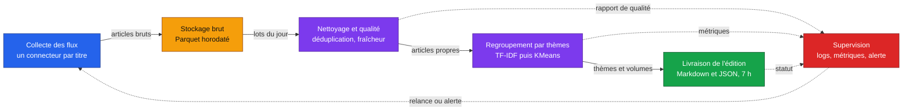

<!-- adam-badges:start -->
[](https://github.com/Adam-Blf/Projet-M2OPS/commits)
[](https://hits.sh/github.com/Adam-Blf/Projet-M2OPS/)
[](https://github.com/Adam-Blf/Projet-M2OPS/commits)
[](https://github.com/Adam-Blf/Projet-M2OPS)
[](LICENSE)
<!-- adam-badges:end -->

# Projet M2Ops, La gazette

Projet certifiant du Bloc 3 du Mastère Data Engineering & IA de l'EFREI,
promotion 2025-2027.

Binôme : **Adam Beloucif** ([Adam-Blf](https://github.com/Adam-Blf)) et
**Emilien Morice** ([emilien754](https://github.com/emilien754)).

## Le projet

**La gazette** produit chaque matin, avant 7 h, une édition qui dit quels sujets
occupent la presse française : les thèmes du jour, les titres qui les traitent,
et où lire la suite. Pas un lecteur d'actualité, un radar éditorial.

Cadre du projet : édition à 7 h, articles de moins de 24 h, conditions des
éditeurs respectées, aucune donnée personnelle, budget zéro, aucun résumé généré
par un LLM, aucun scraping du texte intégral. On ne conserve qu'un titre, un
extrait, un lien et une date.

## Architecture

Le pipeline tient en six boîtes. Chaque TD en construit une ou deux, la fin du
module fait tourner l'ensemble seul, chaque matin.



Le détail des flux, des volumes et de l'hébergement de chaque brique est dans
[docs/architecture.md](docs/architecture.md).

## Livrables du TD 1, cadrage et bornage

| Fichier | Contenu |
|---|---|
| [docs/cadrage.md](docs/cadrage.md) | Besoin reformulé, périmètre, contraintes, stack retenue et alternatives écartées, risques, rôles |
| [docs/architecture.md](docs/architecture.md) | Les six boîtes, ce qui circule entre elles, où ça tourne |
| [sources.csv](sources.csv) | 85 flux vérifiés à la main, 64 PQR et 21 PQN, avec accès, conditions et fréquence mesurée |

## Couverture des sources

Le fichier [sources.csv](sources.csv) tient en six colonnes : nom, type, region,
acces, conditions, notes. Chaque adresse a été ouverte à la main avec un agent
identifié, seuls les flux qui rendent du XML avec des articles sont retenus, et
la note dit ce qu'on a le droit d'en faire, la date du test et le rythme de
publication observé.

| Périmètre | Flux |
|---|---|
| Régions métropolitaines (13) | 64 PQR, deux au minimum par région |
| Outre-mer (5 DROM) | 9 flux, 2 en Guadeloupe et en Martinique, 3 à La Réunion, 1 en Guyane et à Mayotte |
| National | 21 PQN |

Sur 203 adresses testées, 85 rendent un flux exploitable. Les autres refusent les
robots, renvoient du HTML au lieu de XML, ou n'existent plus. Les limites
assumées sont écrites dans la note de cadrage plutôt que masquées : Guyane et
Mayotte restent à une seule source, et aucun média d'extrême droite n'est retenu
malgré un flux parfois valide. Le détail des listes écartées est dans
[docs/cadrage.md](docs/cadrage.md).

## Structure

```
docs/           note de cadrage et schéma d'architecture
sources.csv     sources de presse retenues et vérifiées
```

Les conteneurs, la collecte et la chaîne d'intégration continue arrivent au TD 2.

## Licence

MIT, voir [LICENSE](LICENSE).
