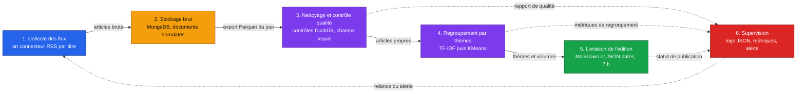

# Architecture cible

Projet M2Ops, TD 1. Ce schéma fixe les six boîtes du pipeline et ce qui circule
entre elles. Chaque TD en construit une ou deux.

## Ce qui circule

| De | Vers | Charge | Volume attendu |
|---|---|---|---|
| Collecte | MongoDB | Un document par article : titre, extrait, lien, date, titre de presse, rubrique | Quelques centaines à quelques milliers de documents par jour |
| MongoDB | Qualité | Export Parquet du jour, relu par DuckDB | Un fichier par jour et par source |
| Qualité | Thèmes | Articles retenus, texte normalisé pour la similarité | Deux tiers du brut environ, doublons et anciens retirés |
| Thèmes | Livraison | Thèmes, articles rattachés, compteurs par titre de presse | Une dizaine de thèmes par jour |
| Toutes | Supervision | Compteurs, durées, erreurs par source | Un enregistrement par étape et par exécution |

DuckDB ne lit pas MongoDB directement : l'export en Parquet est une étape du
pipeline, assumée et décrite, pas un contournement. Elle sert deux fois, pour les
contrôles qualité et pour les agrégats qui nourrissent l'édition.

## Où ça tourne

| Brique | Où | Quand |
|---|---|---|
| Collecte, qualité, thèmes, livraison | Conteneurs Podman sur une machine de l'équipe, ordonnancés par un CronJob Kubernetes local (kind ou minikube) | Chaque nuit, CronJob à 2 h, édition prête avant 7 h |
| MongoDB | Conteneur Podman, volume persistant | En continu |
| Export et éditions | Volume persistant, un dossier par jour | À chaque exécution |
| Chaîne d'intégration continue | GitHub Actions | À chaque poussée et à chaque demande de fusion |
| Supervision | Logs JSON, puis Prometheus et Grafana en conteneurs | En continu |
| Infrastructure décrite | Terraform et Ansible, cible fournie en TD 4 ou TD 6 | À la mise en production |

Les manifestes Kubernetes vivent dans le dépôt, produits depuis les conteneurs
Podman par `podman generate kube`, puis complétés pour le CronJob et les volumes.
Rien n'est lancé à la main le matin : ce qui décrit l'heure de 7 h est versionné.

## Ce que chaque TD ajoute

| TD | Boîtes couvertes |
|---|---|
| TD 2 | Dépôt, conteneurs Podman, premiers manifestes, première CI, aucun flux encore |
| TD 3 | Collecte des flux et stockage MongoDB |
| TD 4 | Nettoyage, contrôles DuckDB et première livraison |
| TD 5 | Regroupement par thèmes et supervision |
| TD 6 | Infrastructure décrite en code, déploiement automatisé |
| Fin de module | Les six boîtes tournent seules, chaque matin, observées et reproductibles |

## Décisions structurantes

1. **Un connecteur par titre de presse**, pas un collecteur générique : un flux
   qui casse ne doit emporter que sa source.
2. **Le brut n'est jamais modifié.** MongoDB conserve le document tel que publié,
   et le nettoyage produit une collection distincte : une édition passée reste
   rejouable à l'identique.
3. **La déduplication est tenue par la base**, par un index unique sur l'URL
   canonique, pas par une comparaison en mémoire qui dépendrait de l'ordre
   d'arrivée.
4. **L'analyse passe par DuckDB**, sur un export Parquet daté : les contrôles
   qualité et les agrégats se réécrivent en SQL, sans serveur à administrer.
5. **Podman plutôt que Docker**, pour construire et exécuter sans démon root, et
   parce que la conversion en manifestes Kubernetes est directe.
6. **L'ordonnancement est décrit dans le dépôt**, sous forme de CronJob : c'est
   ce qui rend l'heure de 7 h vérifiable.
7. **La supervision observe l'absence**, pas seulement l'erreur : un pipeline qui
   ne tourne pas ne produit aucun log d'erreur.
