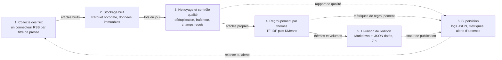

# Architecture cible

Projet M2Ops, TD 1. Ce schéma fixe les six boîtes du pipeline et ce qui circule
entre elles. Chaque TD en construit une ou deux.

## Ce qui circule

| De | Vers | Charge | Volume attendu |
|---|---|---|---|
| Collecte | Stockage brut | Titre, extrait, lien, date, titre de presse, rubrique | Quelques centaines à quelques milliers de lignes par jour |
| Stockage brut | Qualité | Le lot brut de la veille, relu depuis le Parquet | Un fichier par jour et par source |
| Qualité | Thèmes | Articles retenus, texte normalisé pour la similarité | Deux tiers du brut environ, doublons et anciens retirés |
| Thèmes | Livraison | Thèmes, articles rattachés, compteurs par titre de presse | Une dizaine de thèmes par jour |
| Toutes | Supervision | Compteurs, durées, erreurs par source | Un enregistrement par étape et par exécution |

## Où ça tourne

| Brique | Où | Quand |
|---|---|---|
| Collecte, qualité, thèmes, livraison | Conteneurs Docker sur une machine de l'équipe, orchestrés par Docker Compose | Chaque nuit, déclenchement par cron |
| Stockage brut et éditions | Volumes Docker locaux | En continu, un dossier par jour |
| Chaîne d'intégration continue | GitHub Actions | À chaque poussée et à chaque demande de fusion |
| Supervision | Logs JSON en local, puis Prometheus et Grafana en conteneurs | En continu |
| Infrastructure décrite | Terraform et Ansible, cible fournie en TD 4 ou TD 6 | À la mise en production |

## Ce que chaque TD ajoute

| TD | Boîtes couvertes |
|---|---|
| TD 2 | Dépôt, conteneurs, première CI, aucun flux encore |
| TD 3 | Collecte des flux et stockage brut |
| TD 4 | Nettoyage, contrôle qualité et première livraison |
| TD 5 | Regroupement par thèmes et supervision |
| TD 6 | Infrastructure décrite en code, déploiement automatisé |
| Fin de module | Les six boîtes tournent seules, chaque matin, observées et reproductibles |

## Décisions structurantes

1. **Un connecteur par titre de presse**, pas un collecteur générique : un flux
   qui casse ne doit emporter que sa source.
2. **Le brut n'est jamais modifié** : le nettoyage produit un nouveau jeu de
   données, ce qui rend une édition passée rejouable à l'identique.
3. **L'ordonnancement est décrit dans le dépôt**, pas dans une interface : c'est
   ce qui rend l'heure de 7 h vérifiable.
4. **La supervision observe l'absence**, pas seulement l'erreur : un pipeline qui
   ne tourne pas ne produit aucun log d'erreur.
