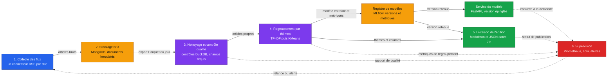

# Architecture cible

Projet M2Ops, TD 1. Ce schéma fixe les six boîtes du pipeline et la branche
modèle du TD 6, plus ce qui circule entre elles. Chaque TD en construit une ou
deux.

## Ce qui circule

| De | Vers | Charge | Volume attendu |
|---|---|---|---|
| Collecte | MongoDB | Un document par article : titre, extrait, lien, date, titre de presse, rubrique | Quelques centaines à quelques milliers de documents par jour |
| MongoDB | Qualité | Export Parquet du jour, relu par DuckDB | Un fichier par jour et par source |
| Qualité | Thèmes | Articles retenus, texte normalisé pour la similarité | Deux tiers du brut environ, doublons et anciens retirés |
| Thèmes | Registre | Matrice TF-IDF, modèle KMeans, hyperparamètres, métriques de cohésion | Un run par entraînement, quelques dizaines par semaine |
| Registre | Livraison | Version du modèle qui a produit l'édition, ses métriques | Une version par jour |
| Registre | Service | Artefact sérialisé et version épinglée | Une image immuable par version |
| Thèmes | Livraison | Thèmes, articles rattachés, compteurs par titre de presse | Une dizaine de thèmes par jour |
| Toutes | Supervision | Compteurs, durées, erreurs par source, logs structurés | Un enregistrement par étape et par exécution |

DuckDB ne lit pas MongoDB directement : l'export en Parquet est une étape du
pipeline, assumée et décrite, pas un contournement. Elle sert deux fois, pour les
contrôles qualité et pour les agrégats qui nourrissent l'édition.

## Où ça tourne

| Brique | Où | Quand |
|---|---|---|
| Collecte, qualité, thèmes, livraison | Conteneurs Podman sur une machine de l'équipe, ordonnancés par un CronJob Kubernetes local (kind ou minikube) | Chaque nuit, CronJob à 2 h, édition prête avant 7 h |
| MongoDB | Conteneur Podman, volume persistant | En continu |
| MLflow, suivi et registre | Conteneur Podman, backend fichier sur volume, base de suivi sauvegardée | À chaque entraînement |
| Service du modèle | Deployment Kubernetes, image épinglée sur la version du jour | En continu, redémarré à chaque nouvelle version |
| Export et éditions | Volume persistant, un dossier par jour | À chaque exécution |
| Chaîne d'intégration continue | GitHub Actions, images poussées sur GHCR | À chaque poussée et à chaque demande de fusion |
| Supervision | Prometheus, Grafana, Loki et Alertmanager en conteneurs | En continu, alerte si l'édition de 7 h manque |
| Infrastructure décrite | Terraform pour les ressources, Ansible pour la machine, consolidés au TD 9 | À la mise en production |

Les manifestes Kubernetes vivent dans le dépôt, produits depuis les conteneurs
Podman par `podman generate kube`, puis complétés pour le CronJob, les volumes et
le Deployment du modèle. Rien n'est lancé à la main le matin : ce qui décrit
l'heure de 7 h est versionné.

## Ce que chaque TD ajoute

Dix séances, et chaque brique de ce schéma arrive dans l'une d'elles.

| TD | Boîtes couvertes | Compétences visées |
|---|---|---|
| TD 1 | Cadrage, sources vérifiées, schéma (ce document) | C7.1 |
| TD 2 | Dépôt, conteneurs Podman, premiers manifestes, première CI, aucun flux encore | C7.1, C7.2, C8.2 |
| TD 3 | Collecte des flux et stockage MongoDB | C7.1, C7.3 |
| TD 4 | Nettoyage, contrôles DuckDB et premiers agrégats | C7.3 |
| TD 5 | Regroupement par thèmes, suivi d'expériences MLflow, registre | C7.4 |
| TD 6 | Évaluation, versionnement et déploiement du modèle, service FastAPI en Deployment | C7.2, C7.4 |
| TD 7 | Édition de 7 h, chaîne complète déclenchée par le CronJob | C7.1, C7.2, C7.3 |
| TD 8 | Supervision Prometheus, Grafana et Loki, alertes, administration | C8.1 |
| TD 9 | Infrastructure en code consolidée, Terraform et Ansible, déploiement rejouable | C8.1, C8.2 |
| TD 10 | Consolidation, rapport technique et soutenance avec démo depuis la production | Toutes |
| Fin de module | Les dix séances passées, le pipeline tourne seul chaque matin, observé et reproductible | |

## Décisions structurantes

1. **Un connecteur par titre de presse**, pas un collecteur générique : un flux
   qui casse ne doit emporter que sa source.
2. **Le brut n'est jamais modifié.** MongoDB conserve le document tel que publié,
   et le nettoyage produit une collection distincte : une édition passée reste
   rejouable à l'identique.
3. **La déduplication est tenue par la base**, par un index unique sur l'URL
   canonique, pas par une comparaison en mémoire qui dépendrait de l'ordre
   d'arrivée.
4. **L'analyse passe par DuckDB**, sur un export Parquet daté : les contrôles
   qualité et les agrégats se réécrivent en SQL, sans serveur à administrer.
5. **Le modèle est un artefact versionné, pas un fichier local.** Chaque
   entraînement entre dans MLflow avec ses hyperparamètres et ses métriques, et
   l'édition cite la version qui l'a produite. Sans ça, deux éditions ne sont pas
   comparables et rien n'est reproductible.
6. **Une seule version sert l'édition et le service.** L'image du service est
   épinglée sur la version retenue, jamais sur `latest` : ce que l'API répond le
   matin est exactement ce que l'édition a publié.
7. **Podman plutôt que Docker**, pour construire et exécuter sans démon root, et
   parce que la conversion en manifestes Kubernetes est directe.
8. **L'ordonnancement est décrit dans le dépôt**, sous forme de CronJob : c'est
   ce qui rend l'heure de 7 h vérifiable.
9. **La supervision observe l'absence**, pas seulement l'erreur : un pipeline qui
   ne tourne pas ne produit aucun log d'erreur, donc l'alerte porte sur la
   métrique « édition du jour absente ».
